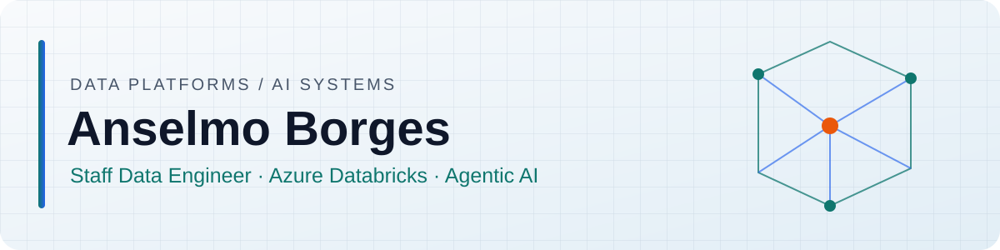
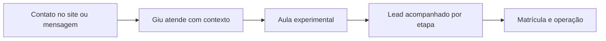

<picture>
  <source media="(prefers-color-scheme: dark)" srcset="assets/banner-dark.svg">
  <source media="(prefers-color-scheme: light)" srcset="assets/banner-light.svg">
  
</picture>

# Anselmo Borges

**Staff Data Engineer** com mais de 15 anos entre engenharia de dados e infraestrutura. Transformo plataformas complexas em produtos de dados governados, eficientes e utilizáveis por pessoas e agentes de IA. Em 2026, levei essa experiência para dois produtos próprios em produção: OceanFlow e DiarIA.

*Data platforms, governance, FinOps and AI agents — from architecture to production.*

[**Produtos próprios**](#produtos-próprios-em-produção--2026) · [**Projetos**](#projetos-em-destaque) · [**Rescue Point**](#rescue-point--ensino-aberto) · [**Experiência**](#experiência) · [**Contato**](#vamos-conversar)

## O que eu entrego

| Plataforma de dados | Engenharia para produção | IA aplicada |
| :--- | :--- | :--- |
| Lakehouse, Azure Databricks, Unity Catalog, integração de fontes e governança. | Spark, dbt, CI/CD, observabilidade, performance e FinOps. | Agentes com MCP, RAG e tool calling sobre dados e sistemas corporativos. |

## Produtos próprios em produção · 2026

Nos projetos abaixo, trabalhei também como **dono do problema**: construí os sistemas, coloquei-os em produção e uso seus dados para melhorar a operação.

### OceanFlow Platform · da experiência no tatame a um produto para academias

Nos últimos **sete meses**, desenvolvi a [OceanFlow Platform](https://oceanflow.platform) a partir da minha experiência como **faixa preta de jiu-jítsu, professor e gestor da [Ocean Flow Studio Fitness](https://oceanflow.fitness/)**, em Maresias. Transformei a rotina de atendimento, aulas, alunos e caixa em uma plataforma **comercializável para academias**, testada diariamente na operação da minha própria academia.

- **Jornada comercial:** a Giu atende no WhatsApp, Instagram e site, acompanha o interesse, encaminha para aulas experimentais e organiza leads por etapa. A jornada vai do primeiro “oi” até a oportunidade de matrícula.
- **Operação:** alunos, matrículas, mensalidades, grade, check-in, evolução no jiu-jítsu e Muay Thai, loja/PDV, Pix e visões distintas para gestão, professores, operação e alunos.
- **Produto e engenharia:** aplicação web, apps para [Android (Google Play)](https://play.google.com/store/apps/details?id=com.oceanflow.academia) e [iPhone/iPad (App Store)](https://apps.apple.com/br/app/ocean-flow/id6813960353), integração com dados e agentes, controle de acesso por perfil e publicação contínua. [Ver arquitetura pública ↗](https://github.com/AnselmoBorges/arquitetura_oceanflow)

<strong>Entenda a jornada: do primeiro contato à matrícula</strong>

Atendimento, aula experimental e acompanhamento por etapa se conectam ao sistema de gestão da academia.

### DiarIA · gestão de hospedagem orientada por dados

Também desenvolvi em **2026** a [DiarIA](https://diaria.in), já em produção para organizar a operação dos meus imóveis de temporada. O produto reúne **agenda e estadias, reservas e canais, despesas e investimentos**, além de indicadores de **ocupação, diária líquida, margem de limpeza e participação por canal**. A proposta comercial é uma gestão por imóvel, com visibilidade para decisões de preço e operação. A DiarIA é a fonte operacional para o negócio; os sites de divulgação e reserva têm funções próprias.

## Projetos em destaque

| Projeto | Arquitetura e resultado demonstrado |
| :--- | :--- |
| **[dbt Moderno na Prática](https://github.com/AnselmoBorges/dbt-moderno-na-pratica)** | Curso aberto com laboratório executável: dbt Core, DuckDB, métricas, testes, contratos, governança, CI, FinOps e MCP. |
| **[dbt + Databricks Asset Bundles](https://github.com/AnselmoBorges/pocdabdbt)** | Pipeline Lakehouse com dbt, GitHub Actions, Unity Catalog e Lakehouse Federation. [Ver aula de deploy DEV → PRD ↗](https://www.youtube.com/watch?v=QjEB3Mkk1GQ) |
| **[Arquitetura Databricks + Azure SQL](https://github.com/AnselmoBorges/dab)** | Automação de ingestão, recursos Azure e organização da governança entre ambientes DEV/PRD. |
| **[dbt com MCP](https://github.com/AnselmoBorges/dbt_com_mcp)** | Laboratório que conecta dbt Core e DuckDB a um servidor MCP. |

<strong>Explorar mais: integração multicloud</strong>

 

- **[Integração multicloud com Unity Catalog](https://github.com/AnselmoBorges/criptorescue):** estudo de federação entre Databricks, BigQuery, Redshift e Azure.

## Rescue Point · ensino aberto

Na [Rescue Point](https://www.youtube.com/@RescuePoint), ensino engenharia de dados gratuitamente com demonstrações de Databricks, dbt, Azure, Apache NiFi e arquitetura aplicada. Os repositórios acima dão contexto e material para praticar.

| dbt Core na prática | Databricks Asset Bundles + GitHub Actions |
| :---: | :---: |
|  |  |
| [Série original ↗](https://www.youtube.com/watch?v=ZAgoqhlR95g&list=PLeblJhqzZe1rvFehI3MsGXmrNch4zQqg8) · [novo laboratório ↗](https://github.com/AnselmoBorges/dbt-moderno-na-pratica) | [Vídeo ↗](https://www.youtube.com/watch?v=QjEB3Mkk1GQ) · [código relacionado ↗](https://github.com/AnselmoBorges/pocdabdbt) |

**Novos vídeos do canal** · [ver todos no YouTube ↗](https://www.youtube.com/@RescuePoint/videos)

<!-- YOUTUBE:START -->
- [Criei uma IA que Atende e Agenda Aulas na Minha Academia \| OpenAI Realtime API](https://www.youtube.com/watch?v=njzJrfJF4jE) · 04/09/2026
- [Integrando o Telegram com o Hermes Agent](https://www.youtube.com/watch?v=0SVTHaCVrtM) · 28/05/2026
- [Instalando o Hermes Agent num Raspberry Pi 4](https://www.youtube.com/watch?v=lKYtbKDFwZw) · 21/05/2026
<!-- YOUTUBE:END -->

## Experiência

Hoje atuo na **CS Global IT Consulting** com engenharia de dados e Agentic AI. Na **Blip**, fui Staff / Sr. Staff Data Engineer, liderando a evolução da plataforma Azure Databricks, governança, eficiência operacional e FinOps. Minha trajetória inclui **Banco Sofisa, Porto, XP, Santander e SPC Brasil**.

<strong>Stack, credenciais e áreas de atuação</strong>

 

**Stack:** Azure · Databricks · Spark / PySpark · Delta Lake · Unity Catalog · ADF · dbt · SQL · Python · GitHub Actions · Linux · MCP · RAG.

**Formação contínua:** Academy Accreditation – Azure Databricks Platform Architect (válida até jul/2027); Applied AI Foundations, Agents and Workflows e AI Foundations (OpenAI).

**Foco:** arquitetura, segurança, governança, observabilidade, custo e operação de produtos de dados e IA.

## Vamos conversar

Precisa evoluir sua plataforma de dados, otimizar workloads ou conectar agentes de IA a dados governados? [**Converse comigo no LinkedIn ↗**](https://www.linkedin.com/in/anselmoborges/) · [**Conheça a Rescue Point ↗**](https://rescuepoint.com.br/).
