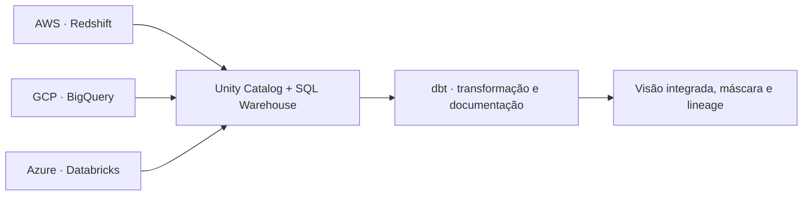

# Case multicloud · Unity Catalog, dbt e criptografia

[← Voltar ao perfil](../README.md) · [Repositório público](https://github.com/AnselmoBorges/criptorescue) · [Vídeo no canal Rescue Point](https://www.youtube.com/watch?v=LxYPpIu7TEQ)

## Contexto

Na minha trajetória na **Porto**, trabalhei com o desafio de integrar dados em ambientes e provedores distintos. Para demonstrar uma abordagem pública e reproduzível, montei uma **POC autoral em contas cloud próprias**: Databricks/Unity Catalog em Azure, Amazon Redshift na AWS e BigQuery no Google Cloud. O objetivo era combinar dados protegidos de três bases em uma visão integrada, mantendo regras coerentes de criptografia e acesso.

Este material descreve a demonstração técnica aberta, **sem expor ambientes, dados ou decisões internas da Porto**.

## Arquitetura demonstrada

- **Federação:** catálogos externos no Unity Catalog para consultar fontes de diferentes clouds e compor uma visão integrada.
- **Transformação:** projetos dbt para preparar o mesmo conjunto de dados em cada provedor e construir as camadas Bronze, Silver e Gold da demonstração.
- **Governança:** mascaramento e lineage examinados no ambiente Databricks.
- **Segurança:** funções de criptografia compatíveis com a necessidade de correlacionar informações protegidas entre as fontes.

Federação reduz a necessidade de **replicação persistente prévia** de todas as tabelas. Ela não elimina transferência de dados durante as consultas; desempenho, custo e políticas de acesso precisam ser avaliados por workload.

## Demonstração pública

No [vídeo da Rescue Point](https://www.youtube.com/watch?v=LxYPpIu7TEQ), mostro a preparação de BigQuery, Redshift e Databricks, as funções de criptografia, a execução dos projetos dbt, o join federado, a máscara, o lineage e a documentação gerada.

**Material:** [código e instruções da POC](https://github.com/AnselmoBorges/criptorescue). É uma demonstração em contas próprias, não uma publicação de infraestrutura corporativa.
